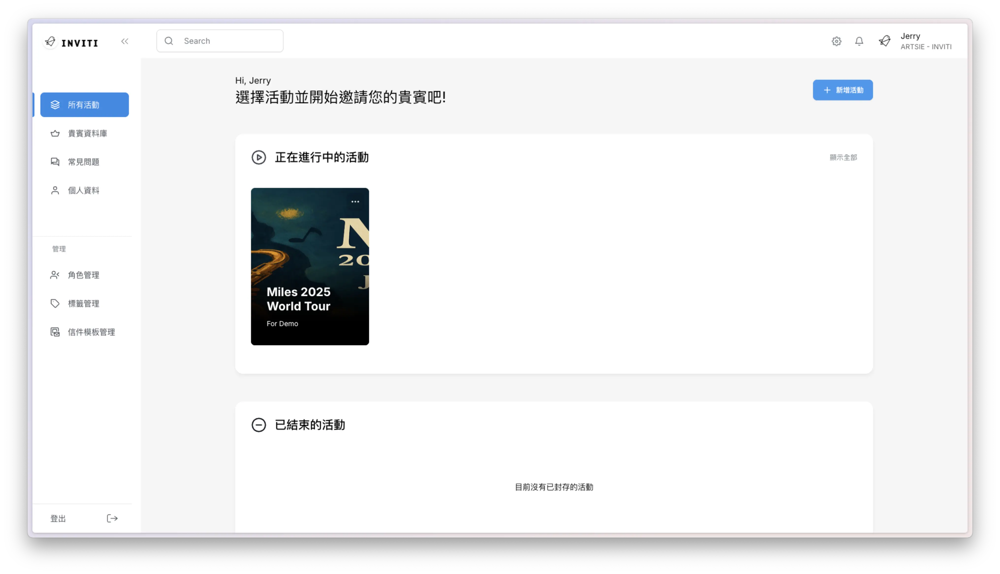
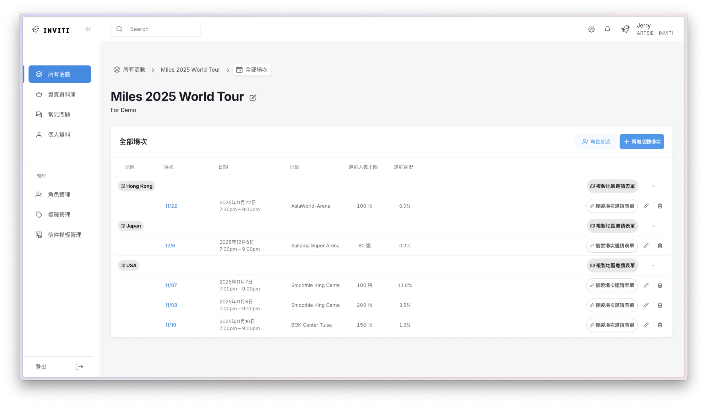
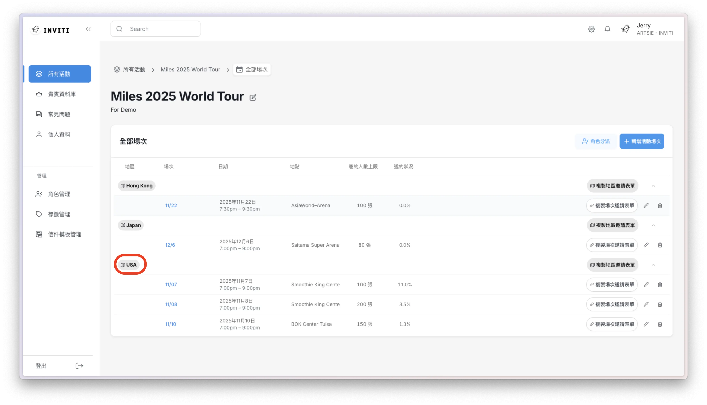
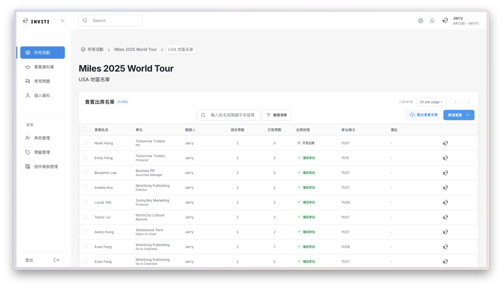
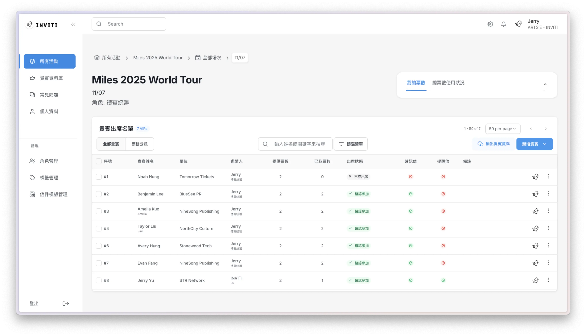
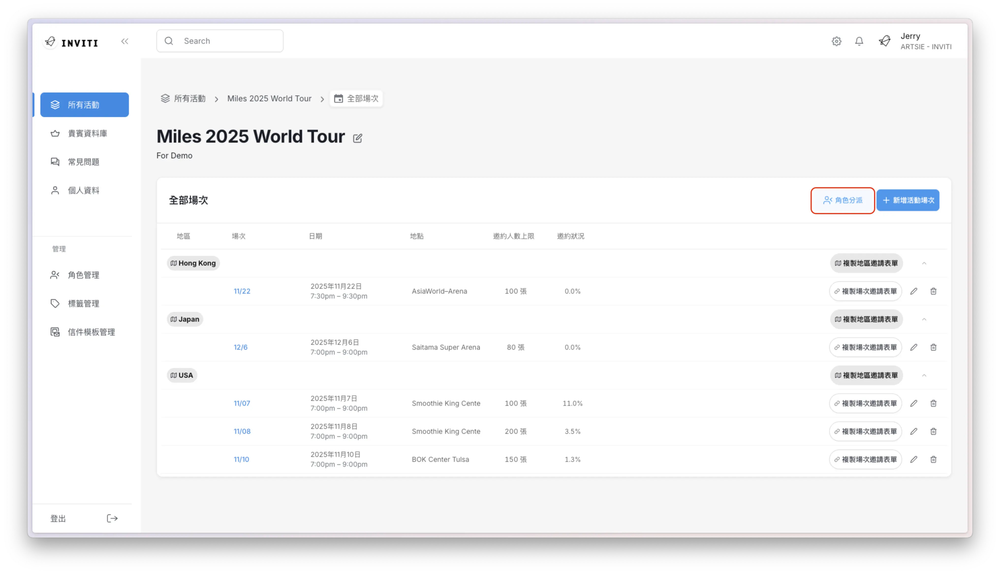
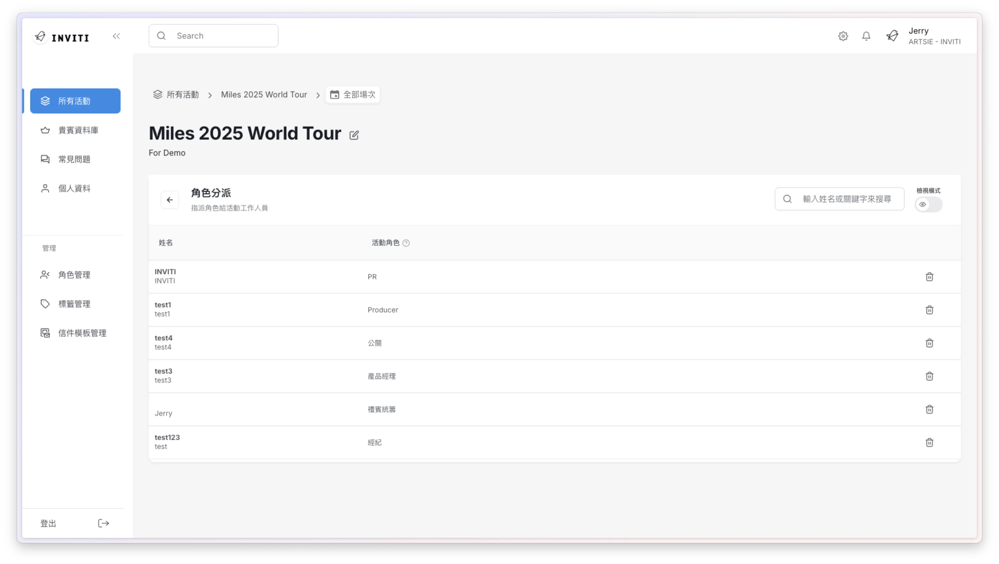
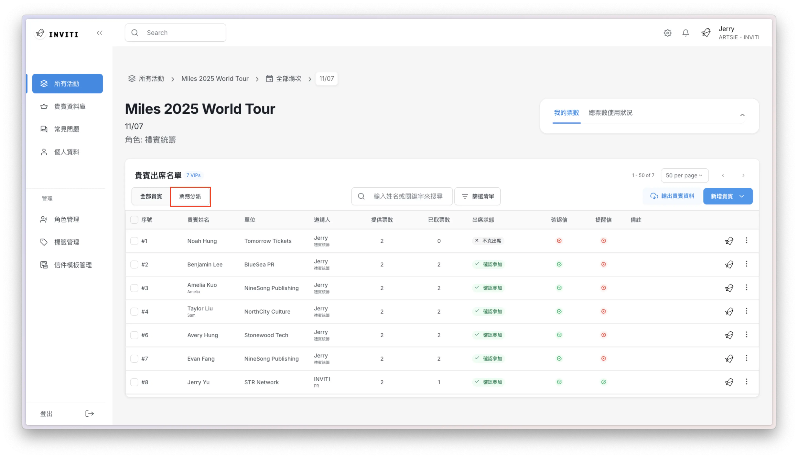
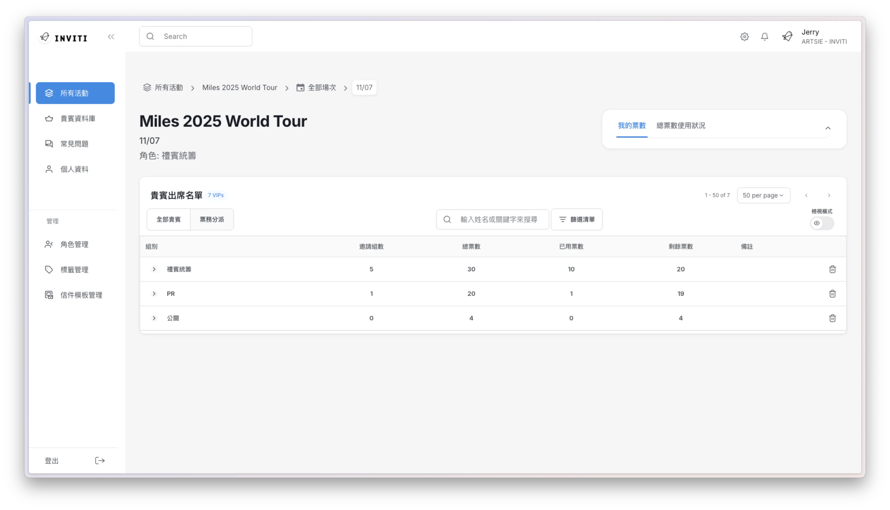
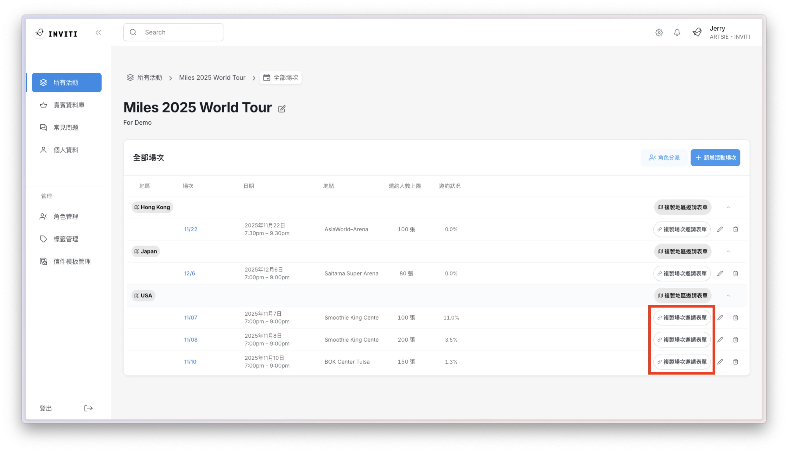

# 名詞定義

## 頁面

- 活動相關
    - 全部活動頁
        
        
        
    - 全部場次頁
        
        
        
    - 地區出席名單頁：該地區中所有場次出席名單總覽，主要用於寄發邀請信
        
        
        
        
        
    - 場次出席名單頁：該場次的所有出席名單，可以編輯貴賓資訊、參與資訊及寄發其他信件
        
        
        
        
        
- 票務相關
    - 角色分派頁：在單一活動中，分派給使用者角色。一位使用者在同一個活動中只能對應到一個角色
        
        
        
        
        
    - 票務分派頁：在單一場次中，分派給角色票數。角色被分派到的票數，不能超過場次「總邀請票數」
        
        
        
        
        

## 邀請表單

- 地區邀請表單
    
    
    
- 場次邀請表單
    
    

## 票數與出席

- **提供票數**：工作人員提供給這位貴賓的票數
- **索取票數**：貴賓實際要出席的人數
- **單場領票上限**：每位貴賓在一個場次最多可以登記的人數，在新增／編輯場次時設定
- **貴賓回覆期限**：貴賓回覆出席的截止日期與時間（時間預設 17:00），到期後邀請表單自動關閉
- **表單狀態**：場次的邀請表單目前是「開放」或「關閉」

## 貴賓自助修改出席

- **我的出席資訊**：貴賓回覆出席後的專屬頁面，可以查看、修改或取消出席
- **修改連結**：進入「我的出席資訊」並可修改的專屬連結，只會寄到貴賓本人的信箱（確認信裡的「修改」按鈕就是修改連結）
- **變更申請**：貴賓增加人數、更換場次時送出的申請，需要審核
- **審核清單**：整個活動所有待審核的變更申請，從活動頁「全部場次」卡片上的「審核清單」按鈕進入
- **變更紀錄**：一位貴賓每一次出席變更的紀錄，在場次出席名單的「更多」選單查看

## 貴賓資料

- **系統編號**：沒有信箱的貴賓，系統自動產生的編號（例如 noemail-000001@inviti.vip），這些貴賓不會收到任何信件
- **邀請表單設定**：每個活動自己決定邀請表單要顯示哪些欄位、哪些必填
