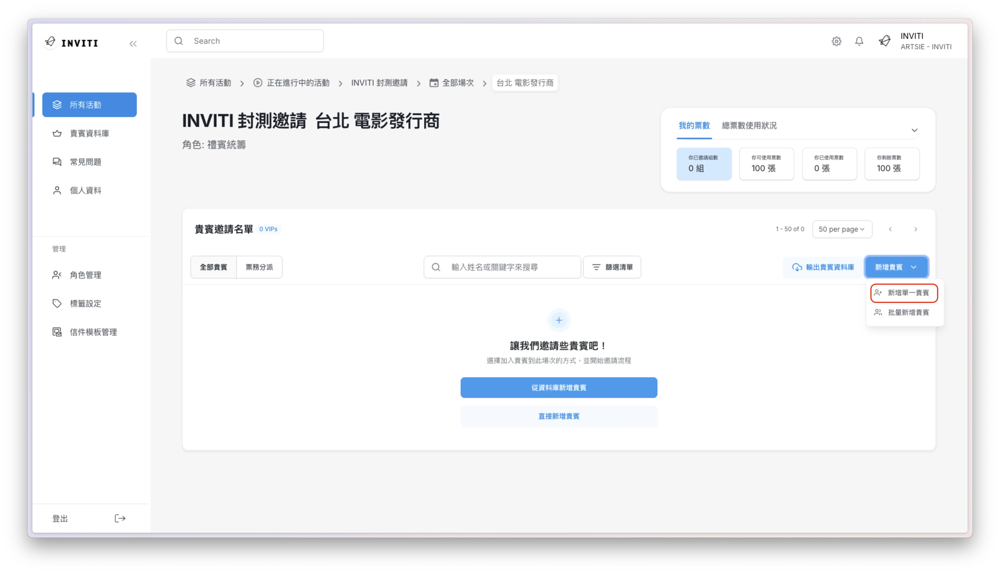

# 貴賓出席名單管理及邀約

## **如何將貴賓加入出席名單？**

### 方法一：使用邀請表單

**使用方式**：活動全部場次列表中，複製「**地區邀請表單**」或「**場次邀請表單**」

**用途：**為減少邀請人一筆一筆輸入貴賓資料的工時，直接將邀請表單提供給貴賓填寫出席資訊

**對象：**
1. 不確定在不在貴賓資料庫中的貴賓，直接給對方邀請表單填寫
2. 透過廣邀，邀請不特定對象的貴賓（例：直接放在網路上讓大家填寫）

**後續操作：**
填寫邀請表單的貴賓，會自動收到「**確認信」**，且貴賓資訊會更新至「邀請名單」及「貴賓資料庫」中。貴賓在表單的留言只會存在這一次的出席紀錄，不會覆蓋貴賓資料庫的「貴賓備註」，請留意留言中是否有特殊需求。

表單要請貴賓填寫哪些資料，可以在活動頁的「**邀請表單**」按鈕設定，詳見〈邀請表單設定〉。

### 方法二：從貴賓資料庫中批量加入

**用途：**貴賓資料庫中已有大量貴賓，可以使用 **標籤篩選、搜尋功能**，一次將多位貴賓加入邀請名單中。通常使用這種方式加入邀請名單的貴賓，都是尚未確認是否出席，僅為邀請人進行名單列舉的工作，因此後續必須要寄出「**邀請信**」或「**確認信**」。

**對象：**已在貴賓資料庫中的貴賓，按照不同活動的目的，使用篩選或搜尋功能找出希望邀請的貴賓

**後續操作：**

1. **在尚未確認對方是否出席的情況下**
必須寄出「**邀請信**」，讓對方填寫出席資訊（例：是否出席、出席人數、備註等）
    
    情境舉例：
    1. 電影首映會，廣發邀約但仍需要確認對方是否出席，若不出席的貴賓可以將票券釋出給第二批次邀請的貴賓。
    2. 為邀請人單方面列舉，貴賓尚未收到任何活動邀請資訊，此時就需要寄出「**邀請信**」進行邀約
    
2. **在已對方確認要出席的情況下**
可以直接寄出**「確認信」**，減少對方還要再填一次邀請表單的時間。寄「**確認信**」的同時，「**索取票數**」會被填入「**提供票數**」的數字
    
    情境舉例：
    1. 不需控制人數上限的活動，寄信只是在通知對方有這個活動，以及提供活動相關資訊
    2. 該位貴賓已經通知邀請人「確認出席」與「相關出席資訊」，就可以直接寄出「確認信」
    

### 方法三：單筆新增貴賓

**用途：**為免除貴賓填表單的工作，請貴賓直接提供個人資料後，由邀請人使用「**新增單一貴賓**」將貴賓加入貴賓邀請名單中。

**對象：**通常會是較**忙碌的高階主管**、**藝人** 或 **不善於填表單的族群**

**後續操作：**
通常用此方式進入邀請名單的貴賓，已經確認好了「**出席場次**」、「**出席人數**」等重要資訊。
因此不需要再寄出一封「邀請信」，可以直接寄出「確認信」。寄出「確認信」的同時，「**索取票數**」會被填入「**提供票數**」的數字，且出席狀態也會自動被更新。

## 如何進行邀約

### **寄出邀請信**

1. 在貴賓出席名單找到要邀約的貴賓
2. 點選該筆資料右側的寄信按鈕，寄出信件
3. 信件種類選擇「邀請信」
4. 確認信件資訊：
    - 收件人名稱及信箱
    - 信件標題
    - CC對象
        ｜請使用半型「,」 隔開不同收件人
        ｜舉例：test@gmail.com, test2@gmail.com, test3@gmail.com
    - 信件內容
        ｜請留意是否有附上表單連結
5. 點選「送出」完成寄信

可依照使用者需求跳過寄送邀約信的流程，直接寄出出席確認信，若直接寄出出席確認信，系統會自動將「索取票數」更新為「提供票數」的數字。

沒有信箱的貴賓（電子信箱為系統編號）無法寄信，請先到貴賓資料填入真實信箱。

### **如何設定貴賓出席人數？**

1. 直接新增貴賓時：
    - 在填寫資料時設定「提供票數」
    - 輸入希望邀請的出席人數
2. 從資料庫新增時：
    - 預設提供2張票
    - 可在貴賓出席名單中編輯票數

### **貴賓如何回覆邀約？**

1. 收到邀請信
2. 點選回覆表單連結
3. 填寫參與意願
4. 選擇參與場次
5. 確認出席人數
6. 送出回覆表單
7. 系統自動更新出席狀態並寄送確認信

### 確認信

- 除了使用寄信功能外，貴賓填寫完邀請表單後系統也會自動發送
    ｜如果您不希望在出席確認信中直接告訴對方可以參與，可以更改出席確認信中的內容，將出席資訊刪除，只告訴貴賓說有收到填寫表單了。
- 內容可於信件模板中調整
- 當貴賓填寫完表單後，系統會自動更新出席狀態

### 提醒信

- 建議活動前1-2天發送
- 可選擇單一或多位貴賓發送
- 預設包含出席相關資訊：
    1. 活動地點
    2. 演出時間
    3. 取票資訊
    4. 聯絡窗口
- 可透過信件範本調整內容

### 批量寄信

1. 在「貴賓出席名單」中，點選欲寄送信件的貴賓左側核取方塊
2. 選擇「批量寄信」
3. 選擇要寄出的信件模板
4. 點選「寄出」完成批量發送

注意事項：

- 無法預覽及編輯信件內容
- 建議先做小規模測試
- 勾選的貴賓中如果有人沒有信箱，寄信視窗會先提醒，這些貴賓會被略過，出席狀態也不會改變
- 寄完後畫面會顯示結果：綠色「成功寄送 n 封郵件！」，有略過時另外顯示黃色「跳過 n 封信件，因貴賓沒有信箱」

## 貴賓回覆後如何調整出席？

### 貴賓如何自己修改出席資訊？

貴賓回覆出席後，確認信裡會有「修改」與「取消出席」按鈕，點開就是貴賓專屬的「我的出席資訊」頁。

- **立即生效**：同一場次減少人數、取消出席
- **需要審核**：增加人數、更換場次（貴賓要填寫 30 字以內的申請原因）
- 貴賓從邀請信的連結進來時只能查看，可以點「寄送修改連結到我的信箱」取得修改連結
- 過了「貴賓回覆期限」或場次表單關閉後，貴賓無法再自行修改，需聯繫邀請人

詳細流程請見〈貴賓自助修改出席及審核〉。

### 如何審核貴賓的變更申請？

- **整個活動一起看**：活動頁「全部場次」卡片上的「**審核清單**」按鈕，有待審核申請時會變成橘色並顯示筆數
- **單一場次**：場次出席名單頁的「**待審核**」篩選，點名單上的「變更申請」標籤直接審核

要不要讓貴賓增加人數、換到其他場次，由禮賓統籌在審核時決定。

### 如何查看貴賓的變更紀錄？

在場次出席名單，點該位貴賓右側的「更多」選單 →「**變更紀錄**」，可以看到每一次出席變更的操作者、內容與時間。

## 如何輸出貴賓名單？

1. 在場次出席名單頁點選「輸出貴賓資料」，或在地區出席名單頁點選「輸出貴賓名單」
2. 在「輸出貴賓名單」視窗選擇排列方式：
    - **序號（登記順序）**：越早登記的越前面
    - **角色**：你的角色組排最前，同組內你邀請的貴賓排最前
    - **邀請人**：同一位邀請人的貴賓排在一起
    - **出席狀態**：確認出席 → 待回覆 → 不克出席 → 已取消
3. 只需要確認出席名單時，勾選「只匯出確認出席的貴賓」
4. 選擇輸出欄位（只能擇一）：
    - **僅輸出現有畫面欄位**：依你在「欄位選項」設定的欄位與順序輸出，前面固定有取票序號、貴賓姓名
    - **輸出所有欄位**：原本的完整格式，後面再加英文姓名、公司電話、窗口單位、提供票數、邀請狀態、確認信、提醒信
5. 點選「下載」

## 如何調整貴賓名單顯示的欄位？

場次出席名單與地區出席名單都可以自己決定要看哪些欄位：

1. 點選名單表頭最右邊的「**欄位選項**」
2. 在視窗中調整：
    - **顯示開關**：打開或隱藏欄位
    - **拖拉排序**：按住欄位左邊的把手上下拖拉，調整欄位順序
    - **恢復預設**：回到原本的欄位
    ｜序號（地區頁是勾選框）、貴賓姓名、操作按鈕固定顯示
3. 點選「儲存」

- 設定存在你自己的帳號，所有活動套用同一套，不會影響其他同事的畫面
- 場次出席名單、地區出席名單各自記一套設定
- 可以選的欄位包含：英文姓名、暱稱 / 藝名、電子信箱、電話、公司電話、職稱、收件地址、飲食禁忌、聯絡人資訊、開車前往、車號
- 欄位多的時候，可以在表格裡往右捲動；貴賓姓名與操作按鈕會固定在畫面上
